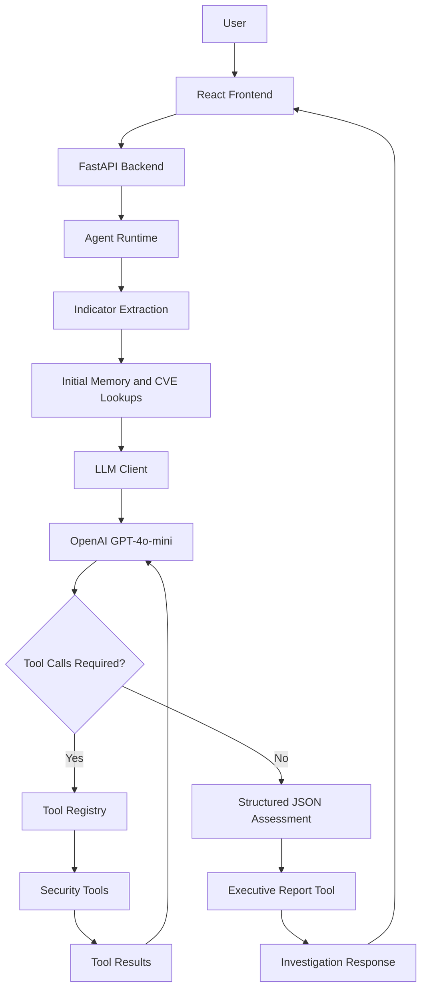
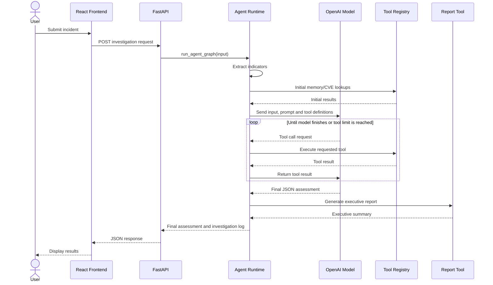
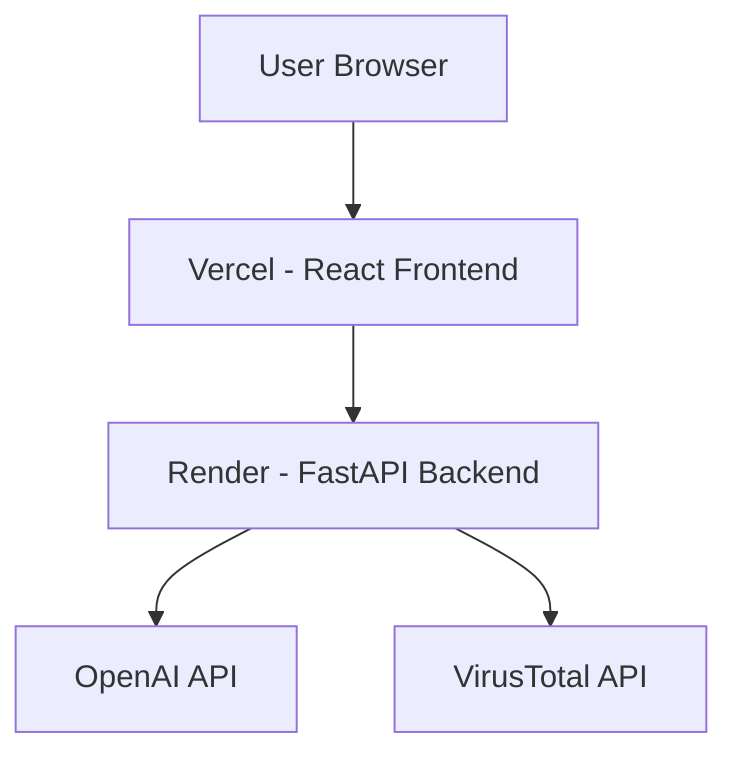

# SentinelAI – System Architecture

## 1. Overview

SentinelAI is an AI-powered Security Operations Center (SOC) investigation application designed to analyze cybersecurity incidents using a language model, security tools, threat intelligence, investigation memory, and automated reporting.

The system combines a React frontend with a Python FastAPI backend. The backend coordinates the investigation process, communicates with the OpenAI API, executes security tools, and returns structured investigation results.

The architecture is designed to support investigation workflows such as:

- Phishing email analysis.
- Suspicious URL investigation.
- Vulnerability identification.
- Threat intelligence lookup.
- Historical investigation correlation.
- MITRE ATT&CK mapping.
- Executive report generation.

## 2. High-Level Architecture



The language model is responsible for selecting additional investigation tools and reasoning over their results. The Python runtime handles initial processing, tool execution, response handling, and report generation.

## 3. Technology Stack

| Component | Technology |
|---|---|
| Frontend | React |
| Frontend build tool | Vite |
| Backend | Python |
| API framework | FastAPI |
| Language model | OpenAI GPT-4o-mini |
| LLM integration | OpenAI Python SDK |
| Tool orchestration | Python tool registry and function calling |
| Threat intelligence | VirusTotal API |
| Vulnerability intelligence | Local CVE knowledge base |
| ATT&CK mapping | Local MITRE knowledge base |
| Investigation memory | JSON-based storage |
| Frontend hosting | Vercel |
| Backend hosting | Render |

## 4. Frontend Architecture

The frontend provides the user interface for submitting cybersecurity incidents and viewing investigation results.

The frontend is built using React and Vite.

### Main frontend components

| File | Responsibility |
|---|---|
| `src/App.jsx` | Main application component |
| `src/main.jsx` | React application entry point |
| `src/api/client.js` | Backend API communication |
| `src/components/Investigator.jsx` | Investigation interface |
| `src/components/Evaluation.jsx` | Evaluation interface |
| `src/components/Investigator.css` | Investigation interface styling |
| `src/App.css` | Application styling |
| `src/index.css` | Global styling |

### Frontend responsibilities

- Accept investigation input.
- Submit investigation requests to the backend.
- Display investigation results.
- Present structured security findings.
- Display evaluation information.

The frontend communicates with the backend through HTTP requests.

## 5. Backend Architecture

The backend is built with Python and FastAPI.

The application is organized into separate modules for API endpoints, agent execution, LLM communication, prompts, and security tools.

### Backend structure

```text
backend/
│
├── app/
│   ├── api/
│   │   └── report.py
│   │
│   ├── core/
│   │   ├── agent_runtime.py
│   │   ├── llm_client.py
│   │   └── tool_registry.py
│   │
│   ├── prompts/
│   │   └── system_prompt.txt
│   │
│   ├── tools/
│   │   ├── email_tool.py
│   │   ├── url_tool.py
│   │   ├── cve_tool.py
│   │   ├── memory_tool.py
│   │   ├── mitre_tool.py
│   │   └── report_tool.py
│   │
│   └── main.py
│
├── evaluation/
│   ├── eval.py
│   ├── eval_dataset.json
│   ├── report.json
│   └── test_cases.json
│
├── tests/
│   └── test_agent_runtime.py
│
├── requirements.txt
├── render.yaml
└── runtime.txt
```

## 6. Agent Runtime

The agent runtime is the central orchestration component.

File:

`app/core/agent_runtime.py`

Its main responsibility is coordinating the investigation process and managing communication between the language model and available security tools.

### 6.1 Indicator Extraction

When an investigation request is received, the runtime extracts:

- Email addresses.
- URLs.
- CVE identifiers.

This initial extraction uses Python regular expressions.

### 6.2 Initial Investigation Lookups

Before the main LLM investigation loop, the runtime performs some automatic lookups:

- Searches investigation memory for extracted email addresses.
- Searches investigation memory for extracted URLs.
- Looks up extracted CVE identifiers using the CVE tool.

The results are added to the investigation log.

### 6.3 LLM Investigation Loop

The runtime then builds the available function-tool definitions and sends the investigation request to the language model.

The model can request additional tool executions.

The process is:

1. The runtime sends the investigation request and available tool definitions to the model.
2. The model decides whether additional tools are required.
3. The runtime receives the requested function calls.
4. The selected tools are executed through the tool registry.
5. Results are returned to the model.
6. The model can request further tool executions.
7. The model produces the final structured assessment.

The runtime allows up to 10 tool-call iterations.

### 6.4 Final Response Handling

When the model finishes its investigation, the runtime:

- Parses the model's JSON response.
- Calls the executive report tool.
- Adds the executive summary to the result.
- Includes the investigation log.
- Returns the final response.

If the model request fails, JSON parsing fails, or the tool-call limit is exceeded, the runtime returns an error response.

## 7. LLM Integration

File:

`app/core/llm_client.py`

The LLM client connects SentinelAI to the OpenAI API.

The configured model is:

`gpt-4o-mini`

The client performs the following operations:

1. Loads environment variables.
2. Reads the system prompt from `app/prompts/system_prompt.txt`.
3. Initializes the OpenAI client using `OPENAI_API_KEY`.
4. Sends the system prompt and investigation messages to the model.
5. Includes the available function tools.
6. Requests a JSON-formatted response.

The model is configured with a temperature of `0.2`.

### System Prompt

File:

`app/prompts/system_prompt.txt`

The system prompt defines SentinelAI's role as a Tier 2 / Tier 3 SOC analyst.

It provides instructions for:

- Selecting investigation tools.
- Analyzing email content.
- Investigating URLs.
- Looking up CVEs.
- Correlating indicators with investigation memory.
- Mapping attacker behavior to MITRE ATT&CK.
- Storing important findings.
- Producing structured JSON assessments.

The prompt also establishes investigation rules and instructs the model not to invent tool results.

## 8. Tool Registry and Function Calling

File:

`app/core/tool_registry.py`

The tool registry maintains the available security tools and their corresponding descriptions, functions, and input schemas.

The runtime uses this registry to construct function definitions that are passed to the OpenAI API.

The model can request tool execution, and the backend executes the selected function.

### Available tools

| Tool | File | Responsibility |
|---|---|---|
| `analyze_email` | `email_tool.py` | Extracts email addresses, URLs, domains, IP addresses, and CVEs |
| `url_reputation_check` | `url_tool.py` | Retrieves URL reputation information from VirusTotal |
| `cve_lookup` | `cve_tool.py` | Retrieves vulnerability information from a local CVE database |
| `memory_lookup` | `memory_tool.py` | Searches historical investigation records |
| `memory_store` | `memory_tool.py` | Stores investigation findings |
| `mitre_mapper` | `mitre_tool.py` | Provides MITRE ATT&CK knowledge |
| `generate_executive_report` | `report_tool.py` | Generates an executive investigation summary |

The project uses model-callable function tools through the OpenAI API. The tool registry provides the execution layer for these functions.

## 9. Security Tool Architecture

### 9.1 Email Analysis

File:

`app/tools/email_tool.py`

The email analysis tool extracts indicators from submitted email content.

It identifies:

- Email addresses.
- URLs.
- IP addresses.
- CVE identifiers.
- Domains.

It also checks for selected URL patterns, including Google Forms, Bitly, and TinyURL links.

The extracted information is returned to the investigation runtime and can support further model reasoning.

### 9.2 URL Reputation Analysis

File:

`app/tools/url_tool.py`

The URL reputation tool integrates with VirusTotal.

It uses the configured `VT_API_KEY` environment variable to authenticate requests.

The tool retrieves available URL information, including:

- Last analysis statistics.
- Reputation.
- URL categories.
- Source availability.

If the API key is missing or the external request fails, the tool returns its result structure with availability information rather than assuming the URL is malicious or safe.

### 9.3 CVE Lookup

File:

`app/tools/cve_tool.py`

The CVE tool provides vulnerability information using a local knowledge base.

The current database includes:

- CVE-2021-44228 – Log4Shell.
- CVE-2017-0144 – EternalBlue.
- CVE-2023-34362 – MOVEit Transfer.

The returned information includes:

- Vulnerability name.
- Severity.
- CVSS score.
- Known exploitation status.
- Description.
- Affected products.
- Recommended actions.

If a CVE is not present in the local database, the tool returns an unknown-CVE result and recommends further validation.

### 9.4 Investigation Memory

File:

`app/tools/memory_tool.py`

The memory tool provides basic historical investigation storage and retrieval.

Memory is stored in:

`investigation_memory.json`

The tool supports:

**Memory lookup**

Searches stored investigation records using a supplied indicator or query.

**Memory storage**

Stores findings with a UTC timestamp.

**Memory statistics**

Returns the number of stored investigation records.

This functionality allows SentinelAI to retain findings and retrieve relevant historical context during later investigations.

### 9.5 MITRE ATT&CK Mapping

File:

`app/tools/mitre_tool.py`

The MITRE tool provides a local knowledge base of attacker behaviors and corresponding MITRE ATT&CK techniques.

The current mappings include:

| Behavior | Technique | Name |
|---|---|---|
| Phishing | T1566 | Phishing |
| Credential access | T1110 | Brute Force |
| PowerShell | T1059.001 | PowerShell |
| Ransomware | T1486 | Data Encrypted for Impact |
| Lateral movement | T1021 | Remote Services |
| Persistence | T1547 | Boot or Logon Autostart Execution |
| Exfiltration | T1041 | Exfiltration Over C2 Channel |

The tool returns the knowledge base and submitted evidence to support investigation mapping.

### 9.6 Executive Report Generation

File:

`app/tools/report_tool.py`

The executive report tool creates a structured report object containing:

- Report type.
- Generation timestamp.
- Executive summary.
- Analyst notes.

The runtime calls this tool automatically after receiving the model's final assessment.

The report summary is based on the investigation reason returned by the model.

## 10. Investigation Workflow

The following sequence illustrates the main investigation process.



## 11. Investigation Output

The model is instructed to return a structured JSON assessment containing:

```json
{
  "verdict": "safe|suspicious|malicious",
  "confidence": 0.0,
  "risk_score": 0,
  "incident_type": "",
  "reason": "",
  "mitre_findings": [],
  "cve_findings": [],
  "executive_summary": ""
}
```

The runtime also attaches an investigation log containing tool names, arguments, and results.

The executive summary is populated using the output of the report-generation tool.

## 12. API Architecture

The backend exposes an investigation endpoint through FastAPI.

The main application entry point is:

`app/main.py`

The investigation request uses an input field containing the incident information.

### Investigation endpoint

| Method | Endpoint | Purpose |
|---|---|---|
| POST | `/investigate` | Submit a cybersecurity investigation |
| GET | `/` | Check backend service status |

The backend processes the request through the agent runtime and returns the investigation result.

FastAPI also provides interactive API documentation through its generated OpenAPI interface.

## 13. Evaluation Architecture

The evaluation framework is located in:

`evaluation/`

Main files:

- `eval.py`
- `eval_dataset.json`
- `report.json`
- `test_cases.json`

The evaluation script runs investigation scenarios through the agent runtime and compares predicted verdicts against expected labels.

The framework calculates:

- Accuracy.
- Precision.
- Recall.
- F1 Score.
- True positives.
- False positives.
- True negatives.
- False negatives.

This provides a structured way to measure investigation performance and identify areas requiring improvement.

## 14. Deployment Architecture

SentinelAI separates the frontend and backend into independently deployed services.



### Frontend Deployment

The React application is deployed using Vercel.

### Backend Deployment

The FastAPI application is deployed using Render.

### External Services

The backend communicates with:

- OpenAI API for model inference.
- VirusTotal API for URL reputation information.

The backend uses environment variables to configure API credentials.

## 15. Environment Configuration

The backend requires the following environment variables:

| Variable | Purpose |
|---|---|
| `OPENAI_API_KEY` | Authenticates requests to the OpenAI API |
| `VT_API_KEY` | Authenticates requests to VirusTotal |

API credentials should be stored securely as environment variables and must not be committed to the public repository.

## 16. Architecture Considerations and Limitations

The current implementation has several important design characteristics.

### Model-driven investigation

The model selects additional function tools during the investigation loop and reasons over the returned results.

### Deterministic preprocessing

The runtime performs initial indicator extraction and selected memory/CVE lookups before the model investigation loop begins.

### Automated reporting

Executive report generation is handled by the Python runtime after the model returns its final assessment.

### Local intelligence databases

The current CVE and MITRE tools use locally defined knowledge bases. They should not be described as live NVD or live MITRE API integrations.

### External API dependency

VirusTotal lookup depends on API credentials, network availability, and external service responses.

### Persistent memory

Investigation memory currently uses a JSON file. It is not a distributed database or a vector database.

These distinctions are important when evaluating the application's capabilities and planning future improvements.

## 17. Future Architecture Improvements

Potential improvements include:

- Expanding vulnerability intelligence with live NVD API integration.
- Adding additional threat intelligence providers.
- Improving investigation memory and historical correlation.
- Introducing persistent database storage.
- Improving tool error handling and retry behavior.
- Expanding evaluation scenarios.
- Improving investigation explainability.
- Adding stronger validation of model-generated assessments.
- Implementing a dedicated MCP server if standards-based MCP transport is required.

## 18. Summary

SentinelAI uses a modular architecture that combines a React frontend, FastAPI backend, OpenAI language model, security tools, investigation memory, and automated reporting.

The agent runtime coordinates the investigation process, while the model selects additional tools and reasons over their results.

The architecture demonstrates how LLM-based reasoning can be combined with deterministic preprocessing, external security intelligence, structured tool execution, and evaluation to build a cybersecurity investigation application.